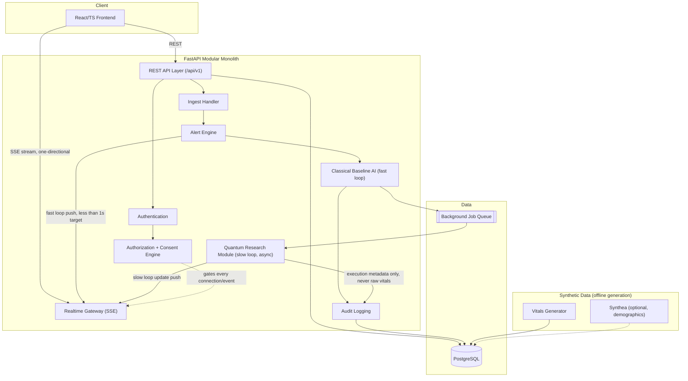

# System Overview — Modular Monolith

Academic RPM prototype. SYNTHETIC / DEMO DATA — NOT REAL PATIENT INFORMATION throughout.
AI outputs are monitoring/research information only, never a diagnosis.

## Principles (unchanged from spec)
Least privilege, defense in depth, secure-by-design, privacy by design, zero trust,
backend-enforced authorization, data minimization, explicit consent, secure key management,
tamper-evident auditing, secure error handling.

## Module boundaries
- **Realtime Gateway** sits beside Authentication/Authorization/Consent as its own trust
  boundary — every SSE connection and every event dispatched through it passes the same
  auth+authz+consent pipeline as REST (see `02-realtime-dataflow.md`).
- **Classical Baseline AI** is fully independent of the quantum module and is the only
  thing the fast loop (ingest → alert push) waits on.
- **Quantum Research Module** never blocks the fast loop; runs as a background job and
  pushes an *update* event when its (benchmarked, non-authoritative) score is ready.
