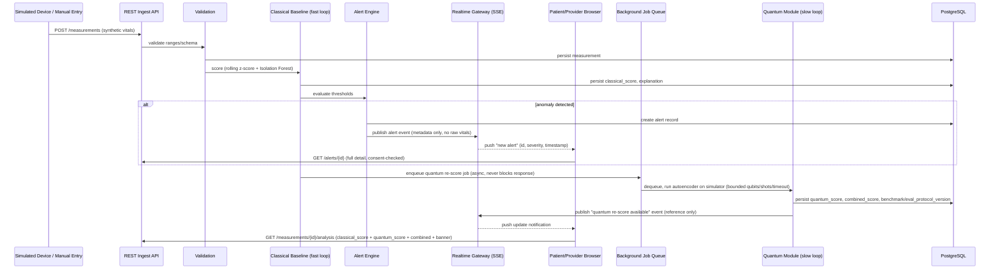
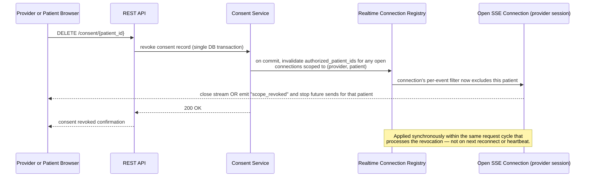

# Real-time send/receive flow (required diagram #11)

## Fast loop + slow loop

Fast loop target: ingest → validation → classical score → alert push, under 1s, and never
waits on the quantum module. Slow loop is best-effort seconds-to-minutes; UI shows
"classical: available now" / "quantum research score: pending → available".

## Consent revocation vs. an open SSE connection

### Mechanism
- `Realtime Connection Registry`: in-process map, `session_id -> {user_id, role, authorized_patient_ids}`.
- Every event about to be yielded by an SSE generator is filtered against the registry entry's
  current `authorized_patient_ids`, re-read at dispatch time — not cached for the connection's
  lifetime.
- The consent-revocation endpoint, inside the same DB transaction/request that commits the
  revocation, calls into the registry to update (or close) any matching open connections
  before returning its HTTP response. No polling delay, no reliance on the client disconnecting.
- Single-process prototype: in-process registry is sufficient (per spec's "don't add a broker
  unless the job queue already needs one" rule). If the background job queue later requires
  a broker (Redis/etc.) for the quantum module, reuse it to fan out revocation signals across
  workers rather than adding a second piece of infrastructure.
